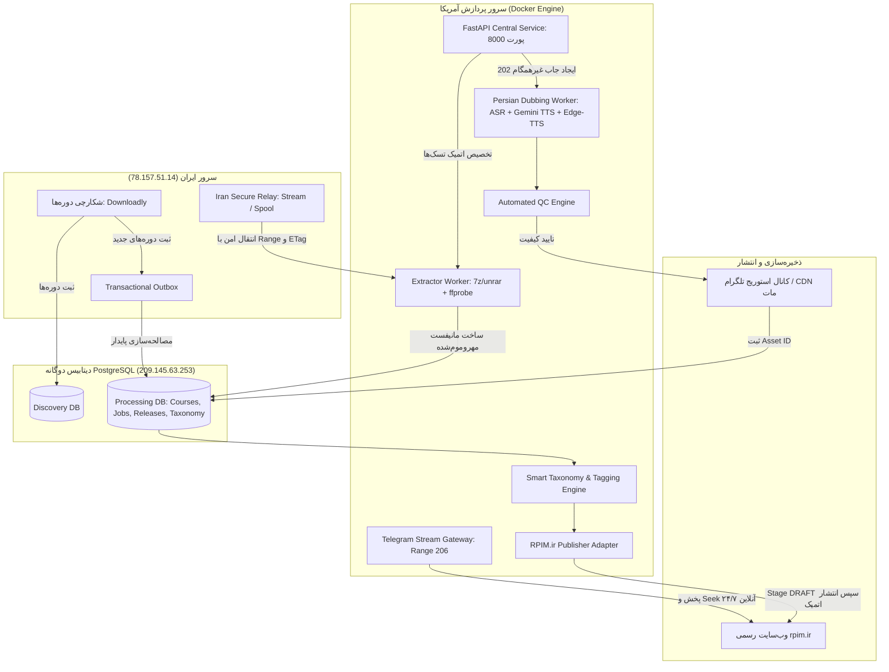

# 📘 راهنمای جامع عملیات، استقرار و بازیابی پایپ‌لاین دوبله و انتشار RPIM TV

این سند راهنمای مهندسی و اجرایی پایپ‌لاین دوره‌های آموزشی RPIM TV است که جزئیات معماری، راه‌اندازی، نظارت، استقرار سرورهای ایران و آمریکا، و پروتکل‌های بازیابی را پوشش می‌دهد.

---

## ۱. معماری سیستم و جریان داده‌ها



### اصول کلیدی معماری:
1. **جداسازی کامل دیتابیس‌ها:** تفکیک فیزیکی یا منطقی `Discovery DB` و `Processing DB` به همراه الگوی Outbox در مبدأ و Inbox یکتا در مقصد.
2. **ارکستراسیون سبک با n8n:** در گردش کار n8n تنها شناسه‌ها و وب‌هوک‌ها رد و بدل می‌شوند؛ ویدیوهای حجیم هرگز وارد مموری یا دیتابیس n8n نمی‌شوند.
3. **پردازش غیرهمگام در WF03:** اندپوینت دوبله درس بلافاصله کد `202 Accepted` با شناسه جاب برمی‌گرداند و درخواست HTTP باز نگه داشته نمی‌شود.
4. **انتقال امن بدون نشت اعتبارنامه:** توکن رله ایران فقط و فقط به سرور رله ارسال می‌شود و هرگز به سمت دامنه مبدا (Downloadly) نشت نمی‌کند.
5. **استریمینگ با پروتکل Range 206:** گیت‌وی محلی پاسخ‌های استاندارد HTTP 206 Partial Content (از جمله open-ended و suffix ranges) ارائه می‌دهد تا بدون افشای لینک‌های تلگرام امکان عقب/جلو بردن ویدیو با عملکرد بالا فراهم شود.

---

## ۲. فهرست اندپوینت‌های API مرکزی (پورت ۸۰۰۰)

| اندپوینت | متد | احراز هویت | شرح وظیفه |
| :--- | :--- | :--- | :--- |
| `/api/v1/health` | GET | عمومی | بررسی وضعیت سلامت سرور |
| `/api/v1/readiness` | GET | عمومی | بررسی اتصال پایدار به دیتابیس‌های Discovery و Processing |
| `/api/v1/discovery/upsert` | POST | داخلی | ثبت Idempotent دوره‌های کشف‌شده و جلوگیری از Event تکراری |
| `/api/v1/discovery/claim` | POST | داخلی | تصاحب اتمیک دوره‌های کشف‌شده با Claim Token و Lease |
| `/api/v1/processing/validate-and-enqueue` | POST | داخلی | دریافت متادیتای غنی، ثبت دوره و صف‌بندی تسک استخراج |
| `/api/v1/lessons/dub` | POST | داخلی | **پاسخ غیرهمگام 202 Accepted** جهت شروع فرایند دوبله درس |
| `/api/v1/jobs/{job_id}` | GET | داخلی | استعلام وضعیت و پیشرفت جاب دوبله (Polling Fallback) |
| `/api/v1/storage/upload-telegram` | POST | داخلی | ثبت Upload Intent، آپلود رسانه و ذخیره شناسه‌ها در CDN تلگرام |
| `/api/v1/lessons/mark-review` | POST | داخلی | ثبت دلایل رد QC و تغییر وضعیت درس به `NEEDS_REVIEW` |
| `/api/v1/courses/check-completeness` | POST | داخلی | صحه‌گذاری ۱۰۰٪ درس‌ها، مانیفست و کنترل کیفیت دوره |
| `/api/v1/courses/emit-ready` | POST | داخلی | ثبت نسخه نهایی دوره و صدور رویداد آمادگی |
| `/api/v1/publish/taxonomy-resolve` | POST | داخلی | تحلیل و انتساب هوشمند دسته‌ها و برچسب‌های تخصصی |
| `/api/v1/publish/stage-draft` | POST | داخلی | ثبت پیش‌نویس (DRAFT) فصول، درس‌ها و فایل‌ها در rpim.ir |
| `/api/v1/publish/commit-visibility` | POST | داخلی | تغییر اتمیک وضعیت انتشار به عمومی (یا ابقای پیش‌نویس) |
| `/api/v1/recovery/reclaim-expired-leases` | POST | داخلی | آزادسازی امن قفل‌های منقضی بر اساس انقضای Lease و Heartbeat |
| `/api/v1/recovery/reconcile-outbox` | POST | داخلی | تطبیق و ارسال مجدد رویدادهای سرگردان Outbox به Inbox |
| `/api/v1/recovery/dead-letter-summary` | POST | داخلی | گزارش خطاهای دائم و تسک‌های هدایت‌شده به Dead-Letter |
| `/api/v1/stream/{asset_id}` | GET/HEAD | عمومی | گیت‌وی استریم ویدیوی تلگرام با پروتکل HTTP 206 و Range/Seek |

---

## ۳. دستورالعمل راه‌اندازی و استقرار سرورها

### الف) استقرار کانتینری با Docker Compose:
در سرور پردازشی آمریکا و رله ایران:
```bash
# کپی تنظیمات نمونه و وارد کردن مقادیر واقعی (بدون قرار دادن در گیت)
cp .env.example .env
nano .env

# راه‌اندازی تمام سرویس‌ها شامل دیتابیس، API، ورکر، n8n و رله ایران
docker compose up -d --build

# بررسی لاگ‌های زنده موتور پردازش و رله
docker compose logs -f engine-api engine-worker iran-relay
```

### ب) استقرار سرویس رله ایران (سرور ایران 78.157.51.14):
سرویس رله به صورت اختصاصی با Dockerfile.relay ساخته شده است:
```bash
docker build -t rpim-iran-relay -f Dockerfile.relay .
docker run -d --name rpim-relay -p 8080:8080 -e RELAY_AUTH_SECRET="your_secret_token" rpim-iran-relay
```

### ج) راه‌اندازی محلی با UV / Python 3.11:
```bash
# نصب وابستگی‌ها
uv pip install -e ".[postgres,test]"

# اجرای مایگریشن‌ها و تست‌ها
uv run python -m pytest -v

# اجرای سرور API
uv run uvicorn server:app --host 0.0.0.0 --port 8000 --reload

# اجرای سرویس رله ایران
uv run uvicorn relay_server:app --host 0.0.0.0 --port 8080 --reload
```

---

## ۴. درون‌ریزی و پیکربندی ورک‌فلوهای n8n

ورک‌فلوهای شش‌گانه در پوشه `workflows/` قرار دارند:
1. `WF01_DISCOVER.json`: پویش و ثبت دوره‌ها در Discovery DB
2. `WF02_DISPATCH.json`: قفل اتمیک دوره‌ها و ایجاد جاب انتقال
3. `WF03_LESSON_PROCESS.json`: خط دوبله غیرهمگام درس‌ها و دریافت نتیجه بدون معطل ماندن HTTP
4. `WF04_FINALIZE.json`: صحه‌گذاری کامل مانیفست و تایید دوره
5. `WF05_PUBLISH.json`: انتساب دسته‌بندی و برچسب‌های هوشمند، Staging و انتشار در rpim.ir
6. `WF06_RECOVER.json`: مانیتورینگ خودکار، بازیابی Leaseهای منقضی و انتقال Outbox

### متغیرهای محیطی مورد نیاز در کانتینر n8n:
- `US_ENGINE_BASE_URL`: آدرس وب‌سرویس انجین (مثلاً `http://engine-api:8000`)
- `IRAN_RELAY_BASE_URL`: آدرس سرور رله ایران (پیش‌فرض `https://rpim.ir`)
- `INTERNAL_API_SECRET`: کلید مشترک احراز هویت درخواست‌های داخلی
- `RELAY_AUTH_SECRET`: توکن اختصاصی احراز هویت در رله ایران

---

## ۵. کنترل کیفیت (QC) و دسته‌بندی هوشمند (Taxonomy)

### قوانین کنترل کیفیت (QC):
- حداقل نسبت مدت زمان ویدیو و سگمنت‌ها: انحراف مجاز کمتر از ۱۵٪ (`QC_MAX_DURATION_DRIFT_RATIO=0.15`).
- نسبت متن فارسی: حداقل ۲۰٪ حروف متن ترجمه‌شده باید از کاراکترهای الفبای فارسی باشند.
- تشخیص سکوت غیرعادی و بریدگی صدا: استفاده از صدای صفر مطلق (`b"\x00"*N`) به عنوان دوبله موفق ممنوع است.
- در صورت رد هر درس، وضعیت آن درس `NEEDS_REVIEW` شده و مانع از آماده‌سازی نهایی دوره در WF04 می‌شود.

### قوانین هوشمند دسته‌بندی و برچسب‌ها:
- نرمال‌سازی کامل کاراکترهای فارسی (یکپارچه‌سازی «ی» و «ک»، حذف نیم‌فاصله‌های مزاحم و تنوین).
- تطبیق چندمرحله‌ای: نام دسته → مترادف‌های انگلیسی/فارسی → نگاشت موضوعی (مانند AI → هوش مصنوعی).
- ایجاد خودکار دسته‌های جدید با رعایت سقف عمق درخت (حداکثر ۳ لایه) و ممانعت از ایجاد موضوعات اختصاصی یک دوره.
- انتخاب ۳ تا ۸ برچسب تخصصی مرتبط با فناوری‌های واقعی درس.
- پشتیبانی از قفل دستی (`is_locked=True`) توسط مدیر، به‌طوری که تکرار تحلیل هرگز انتخاب دستی را تغییر نمی‌دهد.

---

## ۶. پروتکل بازیابی اضطراری و Rollback

در صورت بروز قطعی یا رفتار غیرمنتظره:
1. **توقف ایمن پذیرش دوره‌های جدید:** غیرفعال‌سازی موقت ورک‌فلوهای `WF01` و `WF02` در پنل n8n.
2. **آزادسازی امن قفل‌های منقضی:** فراخوانی اندپوینت بازیابی یا اجرای کوئری هدفمند (بدون آزادسازی ورکرهای فعال):
   ```sql
   -- فقط جاب‌هایی که واقعاً منقضی شده‌اند به صف برمی‌گردند:
   UPDATE dubbing_jobs
   SET status = 'QUEUED', lease_owner = NULL, fencing_token = NULL
   WHERE status = 'PROCESSING' AND lease_expiry < CURRENT_TIMESTAMP;
   ```
3. **عدم آسیب به نسخه قبلی منتشرشده:** آداپتور انتشار تا پیش از تایید ۱۰۰٪ نسخه جدید، نسخه قبلی را به عنوان نسخه فعال سایت حفظ می‌کند.
4. **بررسی صف Dead-Letter:**
   ```sql
   SELECT id, course_id, job_type, error_code, error_details
   FROM dubbing_jobs
   WHERE status = 'DEAD_LETTER';
   ```
