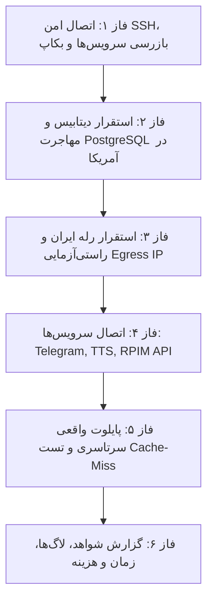

# برنامه عملیاتی استقرار روی سرورها و آزمون سرتاسری واقعی (نسخه v2)

این سند برنامه گام‌به‌گام استقرار تفکیک‌شده پایپ‌لاین RPIM بر روی دو میزبان عملیاتی (سرور رله ایران و سرور پردازش آمریکا)، بازرسی اولیه و صیانت از سرویس‌های موجود، مهاجرت دیتابیس PostgreSQL واقعی، و اجرای پایلوت کنترل‌شده سرتاسری است.

---

## ۱. الزامات بازبینی و تایید کاربر (User Review Required)

> [!IMPORTANT]
> **۱. کلیدها یا دسترسی‌های SSH به سرورها:**
> در بازرسی اولیه، هر دو سرور از طریق پورت ۲۲ در دسترس بوده و نوع احراز هویت `publickey,password` را اعلام کردند، اما هیچ کلید خصوصی یا رمز عبوری روی ماشین محلی برای اتصال به `root@78.157.51.14` یا `root@209.145.63.253` پیکربندی نشده است.
> لطفاً مشخص بفرمایید ورود با چه کاربری (`root`، `coolify`، `ubuntu` و ...) و کدام کلید خصوصی یا رمز انجام می‌شود تا منحصراً برای برقراری اتصال امن SSH استفاده شود (هیچ اطلاعات محرمانه‌ای در لاگ یا چت عمومی نمایش داده نخواهد شد).

> [!IMPORTANT]
> **۲. صیانت از سرویس‌های فعال و عدم ایجاد نمونه دوم n8n:**
> بر روی سرور آمریکا، اگر کانتینر n8n یا پلتفرم Coolify از قبل فعال است، کانتینر موازی ساخته نخواهد شد؛ شش ورک‌فلو با وب‌هوک و متغیرهای جدید به صورت Inactive (غیرفعال) درون‌ریزی می‌شوند تا هیچ اختلالی در ورک‌فلوهای موجود، سایت اصلی، یا سرویس‌های VPN رخ ندهد.

> [!WARNING]
> **۳. سقف هزینه آزمون سرویس‌های ابری (TTS / AI):**
> برای پایلوت واقعی، یک دوره کم‌حجم (۱ درس کوتاه، زیر ۲ دقیقه) انتخاب خواهد شد تا هزینه مدل Gemini TTS و ترجمه زیر **۰.۱۰ دلار** باقی بماند. آیا این سقف هزینه مورد تایید است؟

---

## ۲. سوالات شفاف‌ساز و باز (Open Questions)

1. **روش دسترسی به سرور رله ایران (78.157.51.14):** آیا دسترسی مستقیم SSH پورت ۲۲ برقرار است، یا نیاز به پورت اختصاصی، کلید مشخص، یا دستور استقرار از طریق سرور میانی/پنل است؟
2. **وضعیت دیتابیس فعلی روی آمریکا (209.145.63.253):** آیا PostgreSQL از قبل به عنوان سرویس مستقل در Coolify یا Docker فعال است و باید دیتابیس‌های `rpim_discovery` و `rpim_processing` روی همان ساخته شوند، یا کانتینر اختصاصی `rpim-postgres` روی شبکه ایزوله ایجاد گردد؟

---

## ۳. تغییرات پیشنهادی در فایل‌ها و تفکیک استقرار (Proposed Changes)

### الف) تفکیک Compose برای دو میزبان

#### [NEW] [docker-compose.us.yml](file:///c:/Users/MahdiAhmadi/.antigravity-ide/n8n/docker-compose.us.yml)
مخصوص سرور پردازش آمریکا (`209.145.63.253`):
- `postgres`: دیتابیس PostgreSQL 16 در شبکه داخلی `rpim-internal-net` (پورت ۵۴۳۲ **به هیچ عنوان عمومی نخواهد شد** و صرفاً روی شبکه داخلی Docker یا `127.0.0.1` قابل دسترسی است).
- `engine-api`: وب‌سرویس مرکزی FastAPI پورت ۸۰۰۰ با پشتیبانی از `trust_env=False` و گیت‌وی استریم.
- `engine-worker`: ورکر پردازش ۶ جاب با کنترل Fencing Token، قفل حافظه دیسک، و توقف در صورت شکست QC.
- سرویس `n8n` از این فایل حذف می‌شود تا نمونه تکراری ساخته نشود؛ در صورت نیاز به اجرای محلی کانتینر n8n، یک فایل اختیاری جداگانه ارائه خواهد شد.

#### [NEW] [docker-compose.iran.yml](file:///c:/Users/MahdiAhmadi/.antigravity-ide/n8n/docker-compose.iran.yml)
مخصوص سرور رله ایران (`78.157.51.14`):
- `iran-relay`: وب‌سرویس رله امن (`relay_server.py`) با پورت ۸۰۸۰، احراز هویت با `X-RPIM-Relay-Secret`، پشتیبانی کامل از Range 206 و ضد SSRF.
- `iran-spider`: جاب یا اسکریپت کشف دوره‌ها از مسیر ایران با خروج مستقیم درخواست‌ها از IP ایران.

---

## ۴. مراحل گام‌به‌گام اجرای عملیاتی (Execution Phases)

### فاز ۱: بازرسی اولیه و پشتیبان‌گیری
1. اتصال امن به هر دو سرور با دسترسی‌های اعلامی کاربر.
2. اجرای فرمان‌های سنجش وضعیت:
   - `docker ps`، `docker network ls`، `df -h`، `free -m`.
   - بررسی سرویس‌های فعال شبکه، پورت‌های در حال گوش‌دادن (`ss -tulpn`) و وضعیت Coolify / Nginx / n8n / VPN.
3. تهیه بکاپ از فایل‌های تنظیمات، Volumeهای مرتبط و دیتابیس‌های موجود قبل از هرگونه تغییر، همراه با مستندسازی مسیر بازیابی (Rollback).

### فاز ۲: استقرار سرور آمریکا و مهاجرت دیتابیس
1. ایجاد دایرکتوری مجزای پروژه: `/opt/rpim-engine`.
2. استقرار فایل `docker-compose.us.yml` و فایل متغیرهای محیطی امن.
3. راه‌اندازی کانتینر PostgreSQL و اجرای اسکریپت `scripts/init_postgres_dbs.sql` و میگریشن‌های:
   - `migrations/001_discovery_db.sql` روی `rpim_discovery`
   - `migrations/002_processing_db.sql` روی `rpim_processing`
4. اجرای تست‌های ادغام دیتابیس بر بستر کانتینر واقعی PostgreSQL (فعال‌سازی ۲ تستی که قبلاً اسکیپ می‌شدند).
5. راه‌اندازی `engine-api` و `engine-worker` و بررسی Healthcheck در `/api/v1/health` و `/api/v1/readiness`.

### فاز ۳: استقرار سرور رله ایران و اعتبارسنجی شبکه
1. ایجاد دایرکتوری مجزای پروژه در سرور ایران: `/opt/rpim-relay`.
2. استقرار `docker-compose.iran.yml` و ساخت ایمیج `rpim-iran-relay`.
3. راه‌اندازی سرویس و اجرای تست مسیر خروجی شبکه:
   - اجرای `curl -s https://api.ipify.org` از درون کانتینر رله جهت اثبات خروج ترافیک از IP ایران (`78.157.51.14`).
   - راستی‌آزمایی پاسخ استریم با Range و رد درخواست بدون Secret.

### فاز ۴: درون‌ریزی گردش کارهای n8n و اعتبارسنجی اتصالات
1. بررسی نمونه موجود n8n در سرور؛ استخراج یا تنظیم Credentialهای لازم.
2. درون‌ریزی شش ورک‌فلو (`WF01` تا `WF06`) به صورت **Inactive**.
3. بررسی اتصالات واقعی:
   - تست ربات تلگرام با فراخوانی امن `getMe`.
   - بررسی دسته‌ها و تگ‌های واقعی سایت `rpim.ir` با فراخوانی امن Read-Only.
   - تست تولید یک قطعه صوتی کوتاه نمونه با Gemini TTS و اعتبارسنجی کلید API.

### فاز ۵: اجرای پایلوت واقعی سرتاسری (Live E2E Pilot)
1. انتخاب یک درس آزمایشی کم‌حجم مجاز.
2. اجرای دستی و گام‌به‌گام چرخه:
   `کشف در ایران → ثبت Outbox/Inbox در دیتابیس آمریکا → دانلود از مسیر رله ایران → استخراج و ساخت مانیفست → ASR و ترجمه فارسی → سنتز صوتی فارسی با Gemini TTS → میکس دو ترک → ارزیابی QC → آپلود در چنل تلگرام → دریافت asset_id → تخصیص تگ و دسته‌بندی واقعی → ثبت به عنوان DRAFT در سایت rpim.ir`.
3. **تست تاب‌آوری و بازیابی تلگرام (Cache Miss):**
   - انتقال فایل کش ویدیوی درس به دایرکتوری موقت backup.
   - ارسال درخواست Range و HEAD به `/api/v1/stream/{asset_id}`.
   - اثبات دانلود مجدد و خودکار فایل از Telegram CDN و سرویس‌دهی بدون وقفه ویدیوی استریم.
4. **تست Idempotency و Lease Recovery:**
   - اجرای مجدد ورودی یکسان و اثبات عدم ایجاد دوره، جاب، یا انتشار تکراری.
   - شبیه‌سازی انقضای Lease و بازیابی خودکار جاب.

### فاز ۶: گزارش شواهد، تحویل نهایی و Rollback
- ارائه شناسه دوره، شناسه‌های جاب‌ها، شناسه انتشار پیش‌نویس (DRAFT) در سایت.
- ارائه لینک ویدیو با امکان پخش و Seek آنلاین جهت ارزیابی کیفیت صدای فارسی و همگام‌سازی.
- گزارش دقیق زمان پردازش، منابع مصرفی و هزینه واقعی صرف‌شده.
- ارائه راهنمای Rollback اختصاصی بر اساس شرایط واقعی سرورها.

---

## ۵. طرح راستی‌آزمایی (Verification Plan)

### تست‌های خودکار روی سرور:
- اجرای `uv run pytest -v tests/test_postgres_integration.py` روی سرور آمریکا در برابر کانتینر فعال PostgreSQL.
- اجرای تست اعتبارسنجی Egress IP رله ایران.

### راستی‌آزمایی دستی:
- بررسی پخش استریم در مرورگر با قابلیت عقب/جلو بردن (Seek).
- بررسی پنل مدیریت rpim.ir و رویت رکورد در وضعیت DRAFT بدون انتشار عمومی.
- بررسی لاگ‌های امنیتی کانتینرها جهت تایید عدم نشت هرگونه رمز یا توکن.
